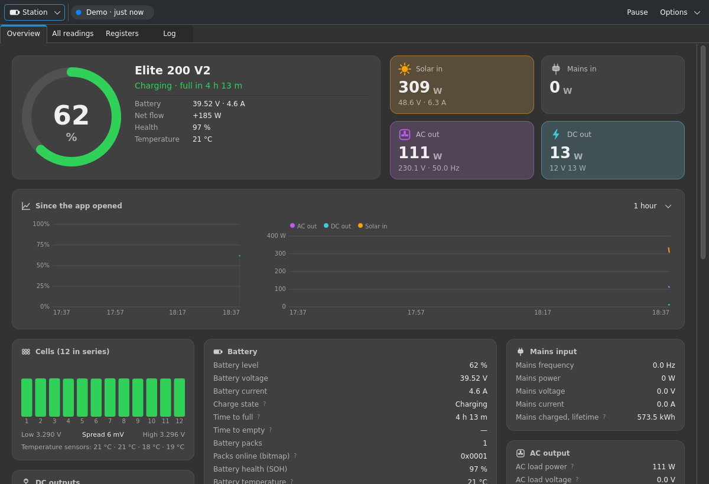

# Bluetti Monitor

An **unofficial** Linux desktop monitor for BLUETTI power stations. It connects over
encrypted Bluetooth LE and shows battery level, power flows, history graphs, cell
voltages, temperatures, energy totals and raw registers, with a battery readout in
the system tray. It only reads from the station and never changes its settings.

Tested with the Elite 200 V2; other V2-protocol models (e.g. Elite 30 V2) should work.




https://github.com/user-attachments/assets/b19fc483-b242-4d83-883b-a822ae6c7041


## Install

From a release bundle:

```
flatpak install bluetti-monitor-1.1.0.flatpak
```

## Run from source

Needs Python 3.10+, PySide6, `cryptography` and `dbus-fast`, plus BlueZ.
`bleak` is bundled in `vendor/`.

```
python3 main.py          # live Bluetooth
python3 main.py --demo   # recorded demo data, no station needed
```

## Build the Flatpak

```
flatpak install flathub org.flatpak.Builder
flatpak run org.flatpak.Builder --user --install --force-clean builddir io.github.usernamedan8.BluettiMonitor.yml
```

## Licence

MIT, see [LICENSE](LICENSE). `vendor/bleak` is MIT ([vendor/bleak-LICENSE](vendor/bleak-LICENSE)).

BLUETTI is a trademark of its owner. This project is not affiliated with or endorsed by BLUETTI.
